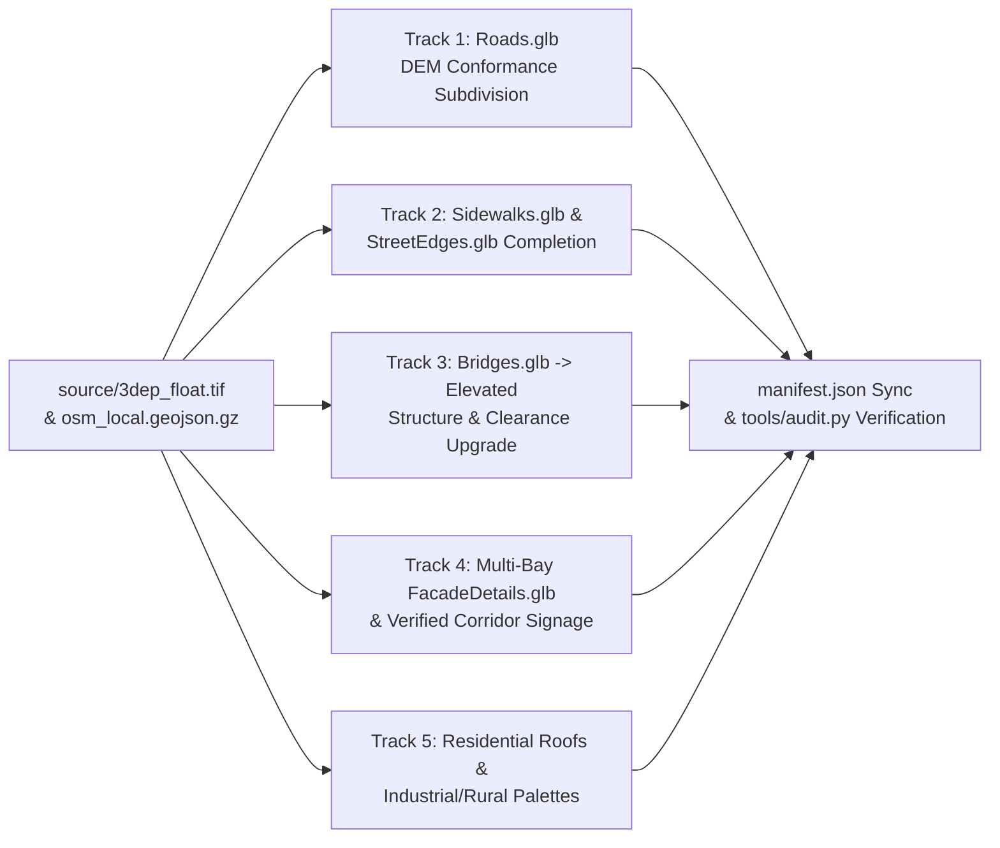

# Harlingen Citywide Visual Restoration Plan (Phase 3)

## 1. Executive Summary & Scope

Following the targeted corridor restorations of **Phase 1 (Downtown Harlingen / Jackson Street in `tiles/+00_+00`)** and **Phase 2 (Ed Carey Drive / Loop 499 & FM 801 across `tiles/+01_+00`, `+01_+01`, `+00_+01`, and `+00_+02`)**, **Phase 3** defines the technical architecture, prioritized district-by-district roadmap, and validation standards to scale visual accuracy and street-level recognizability across the entire **12 × 12 km (144 km²) Harlingen environment**—comprising all **36 independently loadable 2 × 2 km district tiles**.

### 1.1 Non-Destructive Preservation Invariants

All Phase 3 restoration passes operate strictly as additive or in-place geometric and material upgrades within the existing tile architecture:

1. **Geographic Grid & Tile Coordinate System**: All 36 district scenes (`tiles/<id>/district.tscn`) remain anchored to `EPSG:32614` (`UTM Zone 14N`, project origin `Easting 630000, Northing 2898000`, local extent `[-6000..+6000]` m in `X` and `Z`, `2000 × 2000` m per tile).
2. **Source Footprints & Road Networks**: All 29,031 mapped building footprints (`5,786` OpenStreetMap + `23,245` Overture Maps polygons, producing `32,642` modeled building shells/entrances) and `8,196` road/path/rail/waterway vector centerlines from `source/osm_local.geojson.gz` and `source/overture_local.geojson.gz` are preserved at 1:1 planimetric accuracy. Only superseded procedural shells explicitly replaced by custom hero landmark meshes via `replace_shells()` are carved from `Buildings.glb`, `BuildingsFar.glb`, `BuildingCollision.glb`, and `FacadeDetails.glb`.
3. **Dual Terrain & Collision Parity**: Both the native **Terrain3D 1.1.0** runtime (`100` compiled regions in `terrain/regions/*.res` derived from USGS 3DEP elevation data and NAIP orthoimagery) and the static mesh fallback (`TerrainMesh.glb`, `TerrainFar.glb`, `GroundCollision.glb`) remain 100% intact, preserving all **180 shared tile border edges** with zero elevation seam drift.
4. **Gameplay, Streaming & Controller Compatibility**: The first-person walking controller (`preview/walker.gd`, 60 Hz capsule physics), flyover camera (`preview/viewer.gd`, bookmarks `1–4`, `F7/F8/F9` toggles), and distance-based district streaming (`preview/Harlingen.tscn` and `preview/tile.gd`) remain unmodified in behavior while benefiting from corrected road-to-terrain conformance, curb ramp colliders (`StreetRampCollision.glb`), and proper highway overpass clearances.

### 1.2 Citywide Baseline Inventory (36 Districts)

Across all 36 districts, the baseline city build and street-realism layers contain:

| Metric | Citywide Total | Distribution & Baseline Gap Summary |
| --- | ---: | --- |
| **District Tiles (`2 × 2` km)** | `36` | `6 × 6` grid (`-03..+02` in `X` and `Z`) covering `86.54 km²` of the `109.06 km²` Harlingen Census polygon |
| **Mapped Building Footprints** | `29,031` | `5,786` OSM footprints (`19.9%`) + `23,245` Overture ML footprints (`80.1%`) |
| **Modeled Building Shells / Entrances** | `32,642` | `58,968` 3D window frames (`14,926` in `+00_+00`; `44,042` across the remaining 35 tiles at 1 window/building) |
| **3D Raised Curbs (`StreetEdges.glb`)** | `369,161.4 m` | Present in **20 of 36 tiles** (`69,858` slab joints); **16 tiles currently have `0 m` of curbs (`Sidewalks=False`)** |
| **Zebra Crosswalks & Stop Bars** | `8,342` / `8,296` | `16,684` tactile curb ramps (`StreetWear.glb` + `StreetRampCollision.glb`) across `2,595` intersections |
| **Traffic Signals (`signal0` / `signal1`)** | `441` | Instanced via `StreetFurniture.json` across `23` signalized tiles (`127` in `+00_+00` alone) |
| **Utility Poles & Overhead Wire Spans** | `14,637` / `11,991` | `StreetFurniture.json` wooden poles + `StreetWires.glb` 3-wire catenary spans across all 36 tiles |
| **Streetlights, Hydrants & Speed Signs** | `2,875` / `1,375` / `8,383` | `6,501` (`25 mph`), `1,535` (`35 mph`), `347` (`45 mph`), plus `2,202` news boxes and `1,824` mailboxes |
| **Vegetation & Prop Kit (`instances.json`)** | `9,480` | `palm`, `scrub`, `dry_grass`, and legacy street props across 33 tiles (`3` outer tiles have `0` instances) |
| **Elevated Highway Districts (`ElevatedRoads.glb`)** | `6 tiles` | `-02_-01`, `-02_+00`, `-01_+00`, `-01_+01`, `+00_+01`, `+01_+00` (`84` OSM ways, `1,031` pier columns) |
| **Legacy Un-Upgraded Bridges (`Bridges.glb`)** | `21–24 tiles` | `21` primary un-upgraded bridge tiles (`24` total `Bridges.glb` layers / `1,992` tris in `manifest.json`) using `dem + 3.15 m` flat ramps |
| **Custom Landmarks (`Landmarks.glb` / `.tscn`)** | `5 sites` | `Baxter Building` (`+00_+00`), `StripesSunshine` (`+00_-01`), `ValeroLoop499` (`-02_-02`), `HarlingenMedicalCenter` (`+01_+02`), `RamseyTrailhead` (`+01_+00`) |

---

## 2. Prioritized Tier 1–4 District-by-District Restoration Roadmap

### 2.1 Master 36-District Inventory & Restoration Tier Assignment

| Tile ID | World Origin `(X, Z)` | Tier / Phase | Buildings (`OSM` + `Overture`) | Named POIs | Curbs (`m`) | Sidewalks Layer | Crosswalks | Signals | `Bridges` / `Elevated` Tris | Primary Corridor / District Identity |
| --- | --- | --- | ---: | ---: | ---: | :---: | ---: | ---: | ---: | --- |
| `+00_+00` | `(0, 0)` | **Phase 1 & Tier 1.1** | `2,654` (`293` + `2,361`) | `81` | `157,302.5` | Yes | `956` | `127` | `111` / `0` | Downtown Jackson St (Phase 1), S Commerce, Harrison/Tyler |
| `+01_+00` | `(2000, 0)` | **Phase 2 & Tier 2** | `1,836` (`137` + `1,699`) | `14` | `5,959.0` | Yes | `428` | `9` | `75` / `9,416` | N Ed Carey Dr North (Phase 2), E Harrison Ave, Hugh Ramsey Park |
| `+01_+01` | `(2000, 2000)` | **Phase 2 & Tier 2** | `796` (`171` + `625`) | `36` | `4,246.1` | Yes | `230` | `22` | `134` / `0` | N Ed Carey Dr Medical/Retail Core (Phase 2), Business 77, Treasure Hills |
| `+00_+01` | `(0, 2000)` | **Phase 2 & Tier 2** | `1,599` (`72` + `1,527`) | `19` | `12,393.1` | Yes | `211` | `4` | `266` / `3,456` | Ed Carey / I-69E Interchange (Phase 2), S 77 Sunshine Strip |
| `+00_+02` | `(0, 4000)` | **Phase 2 & Tier 2** | `566` (`6` + `560`) | `5` | `0.0` | **No** | `144` | `0` | `0` / `0` | S Ed Carey Dr / FM 801 (Phase 2), Home Depot, Cottonwood Creek CC |
| `-01_+00` | `(-2000, 0)` | **Tier 1.2** | `1,995` (`315` + `1,680`) | `56` | `69,873.6` | Yes | `580` | `46` | `0` / `101,024` | Valle Vista Mall, I-2/I-69E Stack Interchange, W Tyler/Lincoln |
| `+00_-01` | `(0, -2000)` | **Tier 1.3** | `2,301` (`1,061` + `1,240`) | `25` | `52,939.0` | Yes | `656` | `33` | `0` / `0` | Sunshine Strip, N 7th, N 13th, Morgan Blvd Civic Core, City Lake |
| `-01_-01` | `(-2000, -2000)` | **Tier 1.4** | `1,603` (`424` + `1,179`) | `14` | `19,605.7` | Yes | `343` | `5` | `0` / `0` | Lon C. Hill Park, Fair Park, Municipal Auditorium, N Commerce |
| `-02_+00` | `(-4000, 0)` | **Tier 1.5** | `817` (`65` + `752`) | `28` | `7,159.9` | Yes | `259` | `17` | `36` / `86,232` | W Expressway 83 / Dixieland Retail Power Center (Bass Pro Shops) |
| `+01_-01` | `(2000, -2000)` | **Tier 1.6** | `1,353` (`176` + `1,177`) | `15` | `7,113.2` | Yes | `298` | `33` | `0` / `0` | E Morgan Blvd, Loop 499, H-E-B, Pendleton Park (18 sports pitches) |
| `-02_-01` | `(-4000, -2000)` | **Tier 1.7** | `934` (`203` + `731`) | `11` | `1,930.6` | Yes | `273` | `0` | `87` / `10,736` | N Expressway 77 Convention Center, Sam's Club, Performing Arts Ctr |
| `+01_-02` | `(2000, -4000)` | **Tier 2.1** | `545` (`216` + `329`) | `53` | `12,668.2` | Yes | `295` | `29` | `22` / `0` | TSTC Campus, Marine Military Academy, Valley Intl Airport West |
| `+02_-02` | `(4000, -4000)` | **Tier 2.2** | `18` (`17` + `1`) | `17` | `0.0` | **No** | `22` | `0` | `0` / `0` | Valley International Airport (`HRL`) Airfield, Runways & Hangars |
| `+01_+02` | `(2000, 4000)` | **Tier 2.3** | `625` (`14` + `611`) | `8` | `0.0` | **No** | `92` | `3` | `92` / `0` | Harlingen Medical Center, S Expressway 83 / I-69E Southeast |
| `+02_+02` | `(4000, 4000)` | **Tier 2.4** | `967` (`23` + `944`) | `7` | `0.0` | **No** | `199` | `11` | `0` / `0` | San Benito NW / Business 77 SE Corridor, Cameron County Annex |
| `+00_-02` | `(0, -4000)` | **Tier 2.5** | `1,856` (`1,428` + `428`) | `14` | `4,148.5` | Yes | `447` | `24` | `16` / `0` | N 7th St / N Loop 499 High-Density Apartments & Institutional |
| `-01_-02` | `(-2000, -4000)` | **Tier 2.6** | `1,222` (`446` + `776`) | `4` | `2,544.2` | Yes | `293` | `13` | `64` / `0` | N Loop 499 / N 77 Sunshine Strip / N Commerce & UP Rail |
| `-02_-02` | `(-4000, -4000)` | **Tier 2.7** | `654` (`289` + `365`) | `7` | `586.0` | Yes | `205` | `11` | `467` / `0` | Primera Rd / US-77 North Interchange, `ValeroLoop499` landmark |
| `-01_+01` | `(-2000, 2000)` | **Tier 3.1** | `1,007` (`84` + `923`) | `4` | `1,737.4` | Yes | `185` | `2` | `116` / `25,886` | Tony Butler Golf Course, City Reservoir, Rangerville Park, I-69E |
| `+02_+00` | `(4000, 0)` | **Tier 3.2** | `469` (`27` + `442`) | `3` | `1,088.6` | Yes | `133` | `0` | `40` / `0` | Treasure Hills Golf Club, Harlingen Soccer Complex, E Harrison |
| `-03_+00` | `(-6000, 0)` | **Tier 3.3** | `1,093` (`12` + `1,081`) | `7` | `1,207.5` | Yes | `365` | `11` | `126` / `0` | West Harlingen / Dilworth Rd / I-2 Frontage Retail & Golf |
| `-03_-01` | `(-6000, -2000)` | **Tier 3.4** | `1,512` (`45` + `1,467`) | `4` | `15.3` | Yes | `429` | `4` | `0` / `0` | Harlingen Country Club, Stuart Place Rd & Wilson Rd Suburban Core |
| `-03_-02` | `(-6000, -4000)` | **Tier 3.5** | `1,102` (`4` + `1,098`) | `2` | `910.3` | Yes | `208` | `4` | `0` / `0` | Primera / Stuart Place Rd Northwest Suburban Residential |
| `-02_-03` | `(-4000, -6000)` | **Tier 3.6** | `914` (`19` + `895`) | `2` | `4,478.2` | Yes | `181` | `2` | `66` / `0` | Town of Combes, Combes Community Park, I-69E / Business 77 North |
| `-02_+01` | `(-4000, 2000)` | **Tier 3.7** | `734` (`4` + `730`) | `3` | `0.0` | **No** | `180` | `12` | `24` / `0` | Dixieland Park, Shofner Farms Airport, Dixieland Rd Corridor |
| `+02_+01` | `(4000, 2000)` | **Tier 3.8** | `298` (`31` + `267`) | `2` | `0.0` | **No** | `128` | `9` | `18` / `0` | East Treasure Hills Blvd, Business 77 East, Helen Moore Rd |
| `-03_-03` | `(-6000, -6000)` | **Tier 4.1** | `262` (`0` + `262`) | `0` | `665.9` | Yes | `24` | `0` | `0` / `0` | NW Perimeter: TX 107 & North Stuart Place Rd Agricultural Edge |
| `-01_-03` | `(-2000, -6000)` | **Tier 4.2** | `690` (`57` + `633`) | `1` | `0.0` | **No** | `146` | `0` | `26` / `0` | North Perimeter: Combes Rio Hondo Rd & Golf Course / Resacas |
| `+00_-03` | `(0, -6000)` | **Tier 4.3** | `312` (`0` + `312`) | `0` | `0.0` | **No** | `38` | `0` | `22` / `0` | North-Central Perimeter: Combes Rio Hondo Rd & Drainage Canals |
| `+01_-03` | `(2000, -6000)` | **Tier 4.4** | `85` (`0` + `85`) | `0` | `0.0` | **No** | `19` | `4` | `24` / `0` | NE Perimeter: FM 507 & Valley Intl Airport North Runway Approach |
| `+02_-03` | `(4000, -6000)` | **Tier 4.5** | `85` (`0` + `85`) | `0` | `0.0` | **No** | `8` | `0` | `0` / `0` | Far NE Perimeter: North Runway Approach Zone & Irrigation Canals |
| `+02_-01` | `(4000, -2000)` | **Tier 4.6** | `91` (`7` + `84`) | `0` | `0.0` | **No** | `47` | `0` | `0` / `0` | East Perimeter: Number Four Canal, East Airport Perimeter & Farms |
| `-03_+01` | `(-6000, 2000)` | **Tier 4.7** | `886` (`1` + `885`) | `1` | `588.6` | Yes | `190` | `2` | `40` / `0` | SW Perimeter: Garrett Rd, Palm Blvd & Arroyo Colorado West |
| `-03_+02` | `(-6000, 4000)` | **Tier 4.8** | `326` (`0` + `326`) | `0` | `0.0` | **No** | `37` | `0` | `20` / `0` | Far SW Perimeter: Arroyo Colorado River Bends & Agricultural Fields |
| `-02_+02` | `(-4000, 4000)` | **Tier 4.9** | `201` (`0` + `201`) | `0` | `0.0` | **No** | `67` | `0` | `24` / `0` | South-West Perimeter: South Dixieland Rd & Harlingen Main Canal |
| `-01_+02` | `(-2000, 4000)` | **Tier 4.10** | `234` (`0` + `234`) | `0` | `0.0` | **No** | `26` | `4` | `76` / `0` | South-Central Perimeter: Morris Rd, Dixieland Rd & Rangerville Rd |

---

### 2.2 Tier 1 — Primary Commercial, Civic & Retail Spine (7 Districts)

Tier 1 districts carry the highest density of named commercial storefronts, civic landmarks, signalized intersections, and arterial traffic outside the Phase 1 (Jackson Street) and Phase 2 (Ed Carey Drive) corridors.

#### 1. `tiles/+00_+00` — Central Harlingen, South Commerce & Harrison/Tyler Corridors (Post-Phase 1 Scope)
- **Inventory & Metrics**: `2,654` buildings (`293` OSM + `2,361` Overture; `32,642` citywide entrances baseline has `2,654` entrances and `14,926` window frames here), `81` verified named POIs, `157,302.5 m` of curbs (`29,835` slab joints), `956` crosswalks (`1,912` curb ramps), `127` traffic signals, `1,044` utility poles, `232` streetlights, `1,237` vegetation/kit instances, `111` `Bridges.glb` triangles.
- **Major Corridors**: **South Commerce Street**, **West & East Harrison Avenue (`FM 106` / one-way eastbound pair)**, **West & East Tyler Avenue (`Loop 499` / one-way westbound pair)**, **South 77 Sunshine Strip (north segment)**, **1st Street**, and **A Street**.
- **Verified Landmarks, Civic Sites & Parks**:
  - *Completed in Phase 1*: **Baxter Building** (`osm:way:690635467`, `Landmarks.glb` 1,870 tris) and **Jackson Avenue** historic streetscape (`DowntownStreetscape.tscn`).
  - *Remaining Tier 1 POIs*: **Bank of America Tower**, **Creekside Plaza**, **H-E-B (Commerce St)**, **CVS Pharmacy**, **Central Baptist Church**, **First Baptist Church** (`osm:relation:7783027`), **Grace Lutheran Church** (`osm:relation:9395755`), **First Christian Church** (`osm:relation:7483525`), **Centennial Park**, and **Windsor Park**.
- **Specific Restoration Tasks**:
  1. **Expand Priority Facades Beyond `box(70, 195, 735, 590)`**: Extend multi-bay 3D window/door frames and entrance stoops (`priority=True` in `street_detail.py`) south along **S Commerce St** (`Z=590..2000`) and east along **E Harrison Ave & E Tyler Ave** (`X=735..2000`).
  2. **DEM Road Conformance Outside Downtown Box**: Extend `regularize_downtown_road()` triangle subdivision beyond `box(183, 285, 605, 465)` to the wide one-way couples on **Harrison Ave**, **Tyler Ave**, **S Commerce St**, and **Arroyo Colorado** crossing approaches.
  3. **Upgrade Legacy `Bridges.glb` (`111` tris)**: Replace flat `dem + 3.15 m` canal/drainage bridge decks in `+00_+00` with proper concrete parapet/girder profiles and smooth approach transitions.
  4. **Verified Corridor Signage**: Add verified building/pylon signage along **Harrison Ave**, **Tyler Ave**, and **S Commerce St** (Bank of America Tower, H-E-B, Creekside Plaza, CVS Pharmacy, churches).

#### 2. `tiles/-01_+00` — Valle Vista Mall, I-2/I-69E Stack Interchange & West Tyler/Lincoln Commercial Core
- **Inventory & Metrics**: `1,995` buildings (`315` OSM + `1,680` Overture; `2,842` window frames), `56` verified named POIs, `69,873.6 m` of curbs (`13,739` slab joints), `580` crosswalks (`1,160` curb ramps), `46` traffic signals, `749` utility poles, `201` streetlights, `655` prop instances, `101,024` `ElevatedRoads.glb` triangles (`39,368` `ElevatedCollision.glb` tris).
- **Major Corridors**: **I-2 / US-83 & I-69E / US-77 Stack Interchange**, **South Expressway 77 / 83 Frontage Roads**, **West Tyler Avenue**, **West Harrison Avenue**, **West Lincoln Avenue**, **North & South Commerce Street border**, **M Street**, and **F Street**.
- **Verified Landmarks, Retail Anchors & Parks**:
  - **Valle Vista Mall** (`osm:way:204281585`, `X=-1998.57, Z=1258.94`), **Cinemark 16** (`osm:way:498330438`, `X=-1524.11, Z=937.83`), **Walmart Supercenter** (`osm:way:415162585`, `X=-1776.10, Z=1698.35`), and major big-box footprints (Target / Burlington / Marshalls / strip centers).
  - **Hospitality & Dining**: **Courtyard Harlingen**, **Quality Inn** (`osm:way:415162342`), **Olive Garden** (`osm:way:498330434`), **Chili's** (`osm:way:415162457`), **Buffalo Wild Wings**, **Whataburger** (`osm:way:264519412`), **Chick-fil-A**, **Burger King**, **Panda Express**, **Dutch Bros**, **BlueWave Car Wash**, **Central Park Car Wash** (`osm:relation:7385115`), **BBVA** (`osm:relation:8019012`).
  - **Parks & Civic**: **Lt. George Gutierrez Jr. Park**, **Victor Park**, **Harlingen Rotary Bark Park**, and **Harlingen City Cemetery**.
- **Specific Restoration Tasks**:
  1. **Multi-Bay Commercial & Mall Facades**: Upgrade all 56 named retail/restaurant/hotel footprints and **Valle Vista Mall / Walmart Supercenter** to multi-bay `FacadeDetails.glb` rules with recessed storefront glazing, entrance canopies, and stepped entries.
  2. **Frontage Road & Interchange DEM Subdivision**: Subdivide `Roads.glb` (`30,152` tris) along the I-2 / I-69E frontage roads, W Tyler Ave, and W Harrison Ave where wide 5–7 lane intersections cross grade breaks.
  3. **Mall & Highway Pylon/Facade Signage Scene**: Author `ValleVistaStreetscape.tscn` for verified OSM/Overture storefronts (Valle Vista Mall, Cinemark 16, Walmart Supercenter, Olive Garden, Chili's, Whataburger, Quality Inn, Courtyard Harlingen).
  4. **Parking Lot Surface Striping & Lighting**: Add parking aisle markings and high-mast commercial light poles (`light`) across the mapped Valle Vista Mall and Walmart parking lots (`LandCover.glb`).

#### 3. `tiles/+00_-01` — Sunshine Strip, N 7th / N 13th & Morgan Blvd Civic/Commercial Core
- **Inventory & Metrics**: `2,301` buildings (`1,061` OSM + `1,240` Overture; `3,612` window frames), `25` verified named POIs, `52,939.0 m` of curbs (`9,995` slab joints), `656` crosswalks (`1,312` curb ramps), `33` traffic signals, `915` utility poles, `197` streetlights, `536` prop instances, `0` legacy bridges.
- **Major Corridors**: **North 77 Sunshine Strip (`Business 77`)**, **North 7th Street**, **North 13th Street**, **West & East Morgan Boulevard**, and **Austin Avenue**.
- **Verified Landmarks, Civic Buildings & Parks**:
  - *Existing Custom Site Landmark*: **`StripesSunshine`** (`assets/landmarks/StripesSunshine.tscn`, `1,604` tris, footprints `542325799` & `542325801`).
  - **Civic & Institutional Anchors**: **Harlingen Public Library**, **Harlingen Post Office (USPS)**, **HCISD Administration Building**, **Texas Department of Public Safety (DPS) Office**.
  - **Commercial & Retail**: **Liberty Plaza**, **AutoZone**, **BBVA** (`osm:relation:7462103`), **The Courtyard** (`osm:relation:7408759`), **First Church of the Nazarene** (`osm:relation:7844329`).
  - **Parks & Water**: **Lake Harlingen / City Lake Park**, **Bowie Park**, **Hunter Park**, and **Liberty Gardens Park**.
- **Specific Restoration Tasks**:
  1. **Sunshine Strip & Morgan Blvd Sidewalk Continuity**: Fill missing arterial sidewalk and curb segments along the northern half of `+00_-01` (`Z < -600 m`, outside the `is_central` `1050 m` radius where `build.py` stopped auto-generating sidewalks).
  2. **Civic & Retail Priority Facade Pass**: Upgrade **Harlingen Public Library**, **USPS Post Office**, **HCISD Administration**, **Liberty Plaza**, and all **Sunshine Strip** commercial buildings to multi-bay `FacadeDetails.glb` window/door grids.
  3. **Lake Harlingen Shoreline & Road Conformance**: Subdivide `Roads.glb` (`28,373` tris) around **Lake Harlingen / City Lake Park** and drainage crossings to prevent terrain poke-through.
  4. **Sunshine Strip Verified Signage**: Add storefront and monument signs for Harlingen Public Library, Post Office, HCISD Administration, AutoZone, Liberty Plaza, and BBVA.

#### 4. `tiles/-01_-01` — Lon C. Hill Park, Fair Park Civic Complex & North Commerce / Sunshine Strip
- **Inventory & Metrics**: `1,603` buildings (`424` OSM + `1,179` Overture; `2,331` window frames), `14` verified named POIs, `19,605.7 m` of curbs (`3,582` slab joints), `343` crosswalks (`686` curb ramps), `5` traffic signals, `574` utility poles, `141` streetlights, `553` prop instances, `19,749` `Transport.glb` triangles (rail/stadium aprons).
- **Major Corridors**: **North Commerce Street (`Business 77`)**, **North 77 Sunshine Strip**, **West Morgan Boulevard**, **Fair Park Boulevard**, and **L Street**.
- **Verified Landmarks, Civic Complex & Parks**:
  - **Lon C. Hill Park & Fair Park Civic Campus**: **Harlingen Municipal Auditorium** (`osm:relation:8486141`, `X=-941.26, Z=-477.31`), **Harlingen Community Theatre** (`osm:way:548911829`, `X=-822.09, Z=-392.41`), **Harlingen Field (Baseball Stadium)**, **Harlingen Police Department** (`osm:way:612093862`, `X=-674.08, Z=-535.68`), **Boys & Girls Club of Harlingen** (`osm:way:552261639`, `X=-949.31, Z=-214.22`), **Naval Operational Support Center Harlingen** (`osm:way:612093868`, `X=-1215.24, Z=-499.73`).
  - **Commercial & Religious**: **Exxon** (`osm:way:548911784`) & **Tiger Mart** (`osm:way:548911783`), **Queen of Peace Catholic Church** (`osm:way:749082646`), **Templo Fe Esperanza y Amor** (`osm:way:832319549`), **Grace Baptist Church** (`osm:way:1299332226`), and **Vestal Park**.
- **Specific Restoration Tasks**:
  1. **Fair Park Civic Campus Architectural Treatment**: Upgrade **Harlingen Municipal Auditorium**, **Harlingen Community Theatre**, **Harlingen Police Department**, **Boys & Girls Club**, **Naval Operational Support Center**, and **Harlingen Field** to priority multi-bay `FacadeDetails.glb` and add monument signage along **Fair Park Blvd**.
  2. **N Commerce St & W Morgan Blvd Sidewalk/Curb Completion**: Extend continuous sidewalks and 3D bullnose curbs (`Sidewalks.glb` + `StreetEdges.glb`) along the full length of **N Commerce St** and **W Morgan Blvd** outside the central `1050 m` radius.
  3. **Park Grounds & Arroyo/Resaca Grade Conformance**: Subdivide `Roads.glb` (`16,894` tris) along **Fair Park Blvd** and **Lon C. Hill Park** internal park drives where terrain slopes toward drainage channels.

#### 5. `tiles/-02_+00` — West Expressway 83 / Dixieland Retail Power Center
- **Inventory & Metrics**: `817` buildings (`65` OSM + `752` Overture; `1,161` window frames), `28` verified named POIs, `7,159.9 m` of curbs (`1,212` slab joints), `259` crosswalks (`518` curb ramps), `17` traffic signals, `462` utility poles, `166` streetlights, `189` prop instances, `86,232` `ElevatedRoads.glb` triangles (`33,542` `ElevatedCollision.glb` tris), `36` legacy `Bridges.glb` triangles.
- **Major Corridors**: **West Expressway 83 (`I-2` / `US-83`) & Frontage Roads**, **South & North Dixieland Road**, **West Harrison Avenue (`FM 106`)**, **West Tyler Avenue**, and **West Lincoln Avenue**.
- **Verified Landmarks & Retail/Dining Anchors**:
  - **Anchor Retail**: **Bass Pro Shops** (regional destination landmark), **Harlingen Heights Plaza**, **IBC Bank**.
  - **Restaurant Row**: **Cracker Barrel**, **LongHorn Steakhouse**, **Logan's Roadhouse**, **Luby's**, **Hooters**, **Chuck E. Cheese**, **Chick-fil-A**, **Chipotle**.
  - **Civic**: **Harlingen Fire Station #7**.
- **Specific Restoration Tasks**:
  1. **Bass Pro Shops & Retail Power Center Facades**: Upgrade **Bass Pro Shops**, **Harlingen Heights Plaza**, and all 28 named highway restaurants/banks to multi-bay `FacadeDetails.glb` with high-visibility highway signage (`WestExpresswayStreetscape.tscn`).
  2. **Dixieland Rd & Expressway Frontage Sidewalk Expansion**: Extend `Sidewalks.glb` and `StreetEdges.glb` along **Dixieland Rd** and the **W Expressway 83 Frontage Roads** connecting the retail pads.
  3. **Legacy Canal Bridge (`36` tris in `Bridges.glb`) & Road DEM Subdivision**: Upgrade the remaining 36-triangle legacy bridge deck and subdivide `Roads.glb` (`23,656` tris) at the **Dixieland Rd / I-2** frontage intersections.

#### 6. `tiles/+01_-01` — East Morgan Blvd, Loop 499, H-E-B & Pendleton Park
- **Inventory & Metrics**: `1,353` buildings (`176` OSM + `1,177` Overture; `2,305` window frames), `15` verified named POIs, `7,113.2 m` of curbs (`1,552` slab joints), `298` crosswalks (`596` curb ramps), `33` traffic signals, `569` utility poles, `169` streetlights, `496` prop instances.
- **Major Corridors**: **East Morgan Boulevard**, **North Loop 499 (`N Ed Carey Dr` north extension)**, **North 21st Street**, and **Rio Hondo Road**.
- **Verified Landmarks, Retail & Parks**:
  - **Retail & Dining**: **H-E-B & H-E-B Fuel (Morgan Blvd)**, **Sonic**, **Pizza Hut**, **Little Caesars**, **Dollar General**, **Hot Skating Roller Rink**.
  - **Institutional & Residential**: **HCISD Transition Academy**, **Morgan Place Apartments** (`osm:relation:7755839`, `X=2728.90, Z=-1508.39`).
  - **Parks & Channels**: **Pendleton Park** (`18` mapped sports pitches/fields, swimming pool, tennis courts, lake/pond), **Alone Vera Channel** (`osm:way:71731873`), and **Number Three Canal** (`osm:way:1328211164`).
- **Specific Restoration Tasks**:
  1. **Morgan Blvd & Loop 499 Sidewalk/Curb Completion**: Generate continuous sidewalks and 3D bullnose curbs along **E Morgan Blvd** and **Loop 499** connecting **H-E-B** to **Pendleton Park**.
  2. **H-E-B Shopping Center & Apartment Complex Facades**: Apply `priority=True` multi-bay `FacadeDetails.glb` and storefront signage to **H-E-B**, **Hot Skating Roller Rink**, **Morgan Place Apartments**, and strip retail pads at **Morgan Blvd & Loop 499**.
  3. **Canal Crossing Road Subdivision**: Subdivide `Roads.glb` (`19,933` tris) where **E Morgan Blvd** and **Loop 499** cross **Number Three Canal** and **Alone Vera Channel**.

#### 7. `tiles/-02_-01` — North Expressway 77 Convention, Performing Arts & Wholesale Hub
- **Inventory & Metrics**: `934` buildings (`203` OSM + `731` Overture; `1,140` window frames), `11` verified named POIs, `1,930.6 m` of curbs (`347` slab joints), `273` crosswalks (`546` curb ramps), `0` traffic signals, `457` utility poles, `82` streetlights, `204` prop instances, `10,736` `ElevatedRoads.glb` triangles (`4,088` `ElevatedCollision.glb` tris), `87` legacy `Bridges.glb` triangles.
- **Major Corridors**: **I-69E / US-77 (`North Expressway 77`) & Frontage Roads**, **West Teege Avenue**, **North Stuart Place Road / Dixieland Road**, and **Brazil Road**.
- **Verified Landmarks, Civic Venues & Wholesale Anchors**:
  - **Civic & Hospitality**: **Harlingen Convention Center**, **HCISD Performing Arts Center**, **Hilton Garden Inn**, **Texas Department of Motor Vehicles (DMV)**, **Tom Wilson Youth Sports Complex** (`20` mapped sports pitches).
  - **Wholesale & Retail**: **Sam's Club & Sam's Club Fuel**, **C&S Wholesale Grocers** (massive distribution warehouse footprint).
- **Specific Restoration Tasks**:
  1. **Convention Center, Performing Arts & Sam's Club Facades/Signage**: Upgrade **Harlingen Convention Center**, **HCISD Performing Arts Center**, **Hilton Garden Inn**, **Sam's Club**, and **C&S Wholesale Grocers** to priority multi-bay `FacadeDetails.glb` (with warehouse dock bay doors on C&S Wholesale and curtain-wall glazing on the Convention Center / Performing Arts Center).
  2. **Teege Ave & Expressway 77 Frontage Curbs**: Expand `Sidewalks.glb` (`1,930.6 m` baseline) along **W Teege Ave** and the **N Expressway 77 Frontage Rd** serving the Convention Center and Sam's Club.
  3. **Upgrade Legacy `Bridges.glb` (`87` tris)**: Replace the remaining 87 triangles of legacy bridge geometry at canal/frontage crossings with structured bridge decks and subdivide `Roads.glb` (`14,142` tris).

---

### 2.3 Tier 2 — Institutional, Campus, Airport & Secondary Commercial Corridors (7 Districts + Remaining Scope in 4 Phase 2 Tiles)

Tier 2 covers Harlingen's major institutional campuses (**TSTC**, **Marine Military Academy**, **Valley International Airport**), the **Harlingen Medical Center / San Benito Business 77** southeast growth corridor, high-density north apartment districts, and the non-Ed-Carey portions of the four Phase 2 tiles.

#### 8. `tiles/+01_-02` — TSTC Campus, Marine Military Academy & Valley International Airport West
- **Inventory & Metrics**: `545` buildings (`216` OSM + `329` Overture; `723` window frames), **`53` verified named POIs** (3rd highest in the city), `12,668.2 m` of curbs (`2,271` slab joints), `295` crosswalks (`590` curb ramps), `29` traffic signals, `524` utility poles, `120` streetlights, `247` prop instances, `22` legacy `Bridges.glb` triangles.
- **Major Corridors**: **North Loop 499**, **Airport Drive**, **Industrial Boulevard / TSTC Campus Grid**, and **Rio Hondo Road (`FM 106`)**.
- **Verified Landmarks & Campus Buildings**:
  - **Texas State Technical College (TSTC) & Marine Military Academy (MMA) (`53` named buildings)**: **TSTC Administration**, **Cultural Arts Center** (`osm:relation:7841568`, `X=3249.09, Z=-2348.35`), **Transportation Technology Building** (`osm:relation:7841570`, `X=3459.22, Z=-2698.75`), **Aviation Technology**, **Col. Philip J. Yeckel Auditorium**, academic halls, student dormitories, parade grounds, `14` athletic pitches, and western airport hangars.
- **Specific Restoration Tasks**:
  1. **Campus-Wide Multi-Bay `FacadeDetails.glb`**: Currently, 545 buildings in `+01_-02` have only `723` window frames (`~1.3` windows per building). Enabling `priority=True` on all `college`, `school`, `university`, `dormitory`, `civic`, and `hangar` footprints will add multi-bay window grids and double-door institutional entrances across all 53 named TSTC and MMA campus buildings.
  2. **Institutional Campus Signage & Wayfinding**: Add monument signage along **Loop 499** and **Airport Dr** for TSTC, Marine Military Academy, Cultural Arts Center, and Yeckel Auditorium.
  3. **Canal Bridge (`22` tris in `Bridges.glb`) & Road Conformance**: Upgrade the 22-triangle canal bridge and subdivide `Roads.glb` (`15,238` tris) along **Loop 499** and **Airport Dr**.

#### 9. `tiles/+02_-02` — Valley International Airport (`HRL`) Airfield, Terminal & Hangars
- **Inventory & Metrics**: `18` buildings (`17` OSM hangars/terminal + `1` Overture; `18` window frames), `17` aviation POIs, **`0.0 m` of curbs (`Sidewalks=False`)**, `22` crosswalks (`44` curb ramps), `0` signals, `80` utility poles, `207` prop instances, `2,921` `Transport.glb` triangles (runways, taxiways, aprons).
- **Major Features**: **Valley International Airport (`aerodrome`)**, main runways (`17R/35L`, `13/31`, `17L/35R`), taxiways, terminal apron, **Gulf Aviation**, and `16` mapped aircraft hangars.
- **Specific Restoration Tasks**:
  1. **Terminal Drive Sidewalks & Curbs**: Generate `Sidewalks.glb` and `StreetEdges.glb` along the terminal loop road and parking approaches so the airport passenger entry has raised curbs and walkways.
  2. **Hangar & Terminal Facade Treatment**: Replace generic 1-door/1-window residential apertures on the 17 airport hangars with wide rolling hangar-door details and terminal curtain-wall glazing in `FacadeDetails.glb`, plus `"VALLEY INTERNATIONAL AIRPORT"` and `"GULF AVIATION"` signage.
  3. **Runway/Taxiway Edge Conformance**: Audit `Transport.glb` (`2,921` tris) and `Roads.glb` (`2,800` tris) against `TerrainMesh.glb` to eliminate any terrain bleed across flat runway thresholds.

#### 10. `tiles/+01_+02` — Harlingen Medical Center & I-69E Southeast Corridor
- **Inventory & Metrics**: `625` buildings (`14` OSM + `611` Overture; `889` window frames), `8` verified named POIs, **`0.0 m` of curbs (`Sidewalks=False`)**, `92` crosswalks (`184` curb ramps), `3` traffic signals, `239` utility poles, `41` streetlights, `22` prop instances, `92` legacy `Bridges.glb` triangles.
- **Major Corridors**: **I-69E / US-77 / US-83 (`South Expressway 83`) & Frontage Roads**, **Helen Moore Road**, and **Bell Street / Teege South**.
- **Verified Landmarks & Commercial Sites**:
  - *Existing Custom Site Landmark*: **`HarlingenMedicalCenter`** (`assets/landmarks/HarlingenMedicalCenter.tscn`, `25,058` tris, `osm:way:545113288` at `X=2414.3, Z=4176.0`), plus adjacent medical building `osm:way:545113287` (`X=2383.1, Z=4295.5`).
  - **Commercial & Institutional**: **Mad Boar Harley-Davidson**, **Tractor Supply Company**, **Circle K**, **Cash America Pawn**, **Lone Star Inn**, and `5` school buildings.
- **Specific Restoration Tasks**:
  1. **Generate Missing `Sidewalks.glb` & `StreetEdges.glb` (`Sidewalks=False` Fix)**: `+01_+02` currently lacks `Sidewalks.glb` entirely despite containing `HarlingenMedicalCenter`, 92 crosswalks, and major commercial frontage roads. Generate arterial sidewalks and 3D bullnose curbs along the **S Expressway 83 Frontage Roads** and medical campus drives, and switch `Roads.glb` (`12,074` tris) to `curb_asphalt_weather.gdshader`.
  2. **Upgrade I-69E Highway Overpasses (`92` tris in `Bridges.glb`)**: Replace legacy low-clearance `Bridges.glb` mainlane bridges on I-69E with full-clearance elevated highway spans (`5.5 m+` clearance, piers, and girders) matching `ElevatedRoads.glb` in adjacent `+00_+01`.
  3. **Priority Facades & Signage**: Upgrade **Mad Boar Harley-Davidson**, **Tractor Supply Company**, **Circle K**, **Lone Star Inn**, adjacent hospital clinics (`545113287`), and the 5 school buildings to multi-bay `FacadeDetails.glb` with highway pylon signage.

#### 11. `tiles/+02_+02` — San Benito Northwest / Business 77 Southeast Corridor
- **Inventory & Metrics**: `967` buildings (`23` OSM + `944` Overture; `1,260` window frames), `7` verified named POIs, **`0.0 m` of curbs (`Sidewalks=False`)**, `199` crosswalks (`398` curb ramps), `11` traffic signals, `369` utility poles, `79` streetlights, `87` prop instances.
- **Major Corridors**: **Business 77 (`US 77 Business` / West Robertson St / Combes St)**, **I-69E / US-77 / US-83**, **Williams Road**, and **Helen Moore Road**.
- **Verified Landmarks & Civic Sites**: **Cameron County Annex Building**, **San Benito Police Department**, **Bobby Joe Morrow Stadium** (athletic pitch/track), **Stripes**, **Cricket Wireless**, and **Lateral T Canal** (`osm:way:152484764`).
- **Specific Restoration Tasks**:
  1. **Generate Missing `Sidewalks.glb` & `StreetEdges.glb` (`Sidewalks=False` Fix)**: Despite `199` zebra crosswalks (`398` curb ramps in `StreetWear.glb`) and `11` signalized intersections, `+02_+02` currently has zero sidewalks or curbs! Generate `Sidewalks.glb` and `StreetEdges.glb` along **Business 77** and signalized collector streets, trimming curb ramps cleanly against the 398 existing ramp placements.
  2. **Civic & Corridor Priority Facades**: Upgrade **Cameron County Annex Building**, **San Benito Police Department**, **Stripes**, and **Business 77** commercial buildings to multi-bay `FacadeDetails.glb` and add civic/commercial signage.
  3. **Canal & Arterial Road Subdivision**: Subdivide `Roads.glb` (`12,851` tris) across **Lateral T Canal** and **Business 77** intersections.

#### 12. `tiles/+00_-02` — North 7th Street & North Loop 499 High-Density Residential & Institutional
- **Inventory & Metrics**: `1,856` buildings (`1,428` OSM + `428` Overture; `2,403` window frames), `14` verified named POIs, `4,148.5 m` of curbs (`780` slab joints), `447` crosswalks (`894` curb ramps), `24` traffic signals, `692` utility poles, `129` streetlights, `308` prop instances, `16` legacy `Bridges.glb` triangles.
- **Major Corridors**: **North Loop 499**, **North 7th Street**, **North 77 Sunshine Strip**, and **Markowsky Avenue**.
- **Verified Landmarks & Institutional Sites**: **Harlingen Fire Station No. 3**, **Tropical Texas Behavioral Health**, **Valley View Apartments** (`osm:relation:7408760`, `X=1014.98, Z=-2366.21`) + `92` mapped apartment buildings, **Storage Depot** (`osm:relation:7508907`, `X=606.65, Z=-3201.19`), `6` school buildings, and `4` churches.
- **Specific Restoration Tasks**:
  1. **Multi-Story Apartment & School Facade Pass**: Upgrade all `92` mapped apartment buildings (`building=apartments`), `6` schools, **Harlingen Fire Station No. 3**, and **Tropical Texas Behavioral Health** to multi-bay `FacadeDetails.glb` so multi-family and institutional buildings display full window rows instead of a single window.
  2. **N 7th St & Loop 499 Curb Expansion**: Expand `Sidewalks.glb` (`4,148.5 m` baseline) along **N 7th St** and **N Loop 499** to connect all 24 signalized intersections.
  3. **Canal Bridge (`16` tris in `Bridges.glb`) & Road DEM Conformance**: Upgrade the 16-triangle canal bridge and subdivide `Roads.glb` (`17,540` tris).

#### 13. `tiles/-01_-02` — North Loop 499 / Sunshine Strip / North Commerce & UP Rail Corridor
- **Inventory & Metrics**: `1,222` buildings (`446` OSM + `776` Overture; `1,519` window frames), `4` verified named POIs, `2,544.2 m` of curbs (`460` slab joints), `293` crosswalks (`586` curb ramps), `13` traffic signals, `539` utility poles, `98` streetlights, `193` prop instances, `64` legacy `Bridges.glb` triangles, `4,721` `Transport.glb` triangles (Union Pacific rail junction).
- **Major Corridors**: **North Loop 499**, **North 77 Sunshine Strip**, **North Commerce Street (`Business 77`)**, **Wilson Road**, and **Union Pacific Harlingen/Brownsville Subdivision Railroad**.
- **Verified POIs**: **La Sierra Event Center** (`osm:way:599064323`, `X=-1986.61, Z=-3747.65`), **Autos Y Mas** (`osm:way:511190545`, `X=-1043.37, Z=-3263.57`), plus industrial/commercial warehouses along N Commerce St and the UP rail corridor.
- **Specific Restoration Tasks**:
  1. **Arterial Sidewalk & Curb Completion**: Extend `Sidewalks.glb` and `StreetEdges.glb` along **N Loop 499**, **N 77 Sunshine Strip**, and **N Commerce St** across all 13 signalized intersections.
  2. **Rail Crossing & Canal Bridge Upgrades (`64` tris in `Bridges.glb`)**: Subdivide `Roads.glb` (`10,946` tris) at the Union Pacific grade crossings and upgrade the 64 triangles of legacy `Bridges.glb`.
  3. **Commercial & Event Center Facades**: Upgrade **La Sierra Event Center**, **Autos Y Mas**, and N Commerce commercial buildings to multi-bay `FacadeDetails.glb`.

#### 14. `tiles/-02_-02` — Primera Road / US-77 North Interchange
- **Inventory & Metrics**: `654` buildings (`289` OSM + `365` Overture; `962` window frames), `7` verified named POIs, `586.0 m` of curbs (`104` slab joints), `205` crosswalks (`410` curb ramps), `11` traffic signals, `386` utility poles, `75` streetlights, `55` prop instances, **`467` legacy `Bridges.glb` triangles** (highest in the city!).
- **Major Corridors**: **I-69E / US-77 (`North Expressway 77`)**, **West Loop 499 / Primera Road**, and **North Business 77**.
- **Verified Landmarks & Commercial Sites**:
  - *Existing Custom Site Landmark*: **`ValeroLoop499`** (`assets/landmarks/ValeroLoop499.tscn`, `1,207` tris, footprints `498135174` & `498135173` at `X=-2041.06, Z=-3381.40`).
  - **Commercial**: **Stripes** (`osm:way:498135174`), **O'Reilly Auto Parts** (`osm:way:544832243`, `X=-2026.70, Z=-3472.75`), **Church's Chicken**, and **Mr. G's Fireworks**.
- **Specific Restoration Tasks**:
  1. **Critical US-77 Overpass Upgrade (`467` tris in `Bridges.glb`)**: `-02_-02` contains the largest un-upgraded highway bridge complex in the project (`467` triangles on I-69E / US-77 where `elevated_roads.py` terminated at the `-02_-01` border). Upgrade these US-77 mainlane overpasses to full-clearance elevated decks with concrete piers and girders matching `ElevatedRoads.glb`.
  2. **Primera Rd / Loop 499 Commercial Facades & Curbs**: Expand `Sidewalks.glb` (`586.0 m` baseline) along **Primera Rd / Loop 499** across the 11 signalized junctions and upgrade **O'Reilly Auto Parts**, **Church's Chicken**, and **Mr. G's Fireworks** to multi-bay `FacadeDetails.glb` with signage.

#### Phase 2 Tiles — Remaining Non-Ed-Carey District Tasks (`+01_+00`, `+01_+01`, `+00_+01`, `+00_+02`)
While the 250 m **Ed Carey Drive** corridor is restored in Phase 2, the remainder of these four tiles is scheduled in Phase 3 Tier 2:
- **`tiles/+01_+00` (Outside Ed Carey Dr)**: Subdivide `Roads.glb` along **East Harrison Ave (`FM 106`)** and **East Tyler Ave** (`X=2000..3587`); upgrade `75` legacy `Bridges.glb` triangles on **Number Three Canal** / **Little Creek**; apply multi-bay `FacadeDetails.glb` to E Harrison commercial buildings and apartment complexes (`Building O/P`).
- **`tiles/+01_+01` (Treasure Hills Medical Campus & Business 77 East, `d > 250 m` from Ed Carey)**: Upgrade the **Treasure Hills Medical Campus** (**Rio Grande Valley Cancer Treatment Center** `osm:way:545571445`, **Treasure Hills Imaging Center** `544903250`, **Su Clinica Familiar** `545571444`, **Academic and Clinical Research Building** `545571438`, **VA Health Care Center at Harlingen** `545571430`), **Texas Roadhouse** (`560844466`), and **Church's Chicken** (`502734859`) to priority multi-bay `FacadeDetails.glb` with medical campus monument signage; upgrade `134` legacy `Bridges.glb` triangles; extend sidewalks along **Treasure Hills Blvd** and **Business 77**.
- **`tiles/+00_+01` (S 77 Sunshine Strip & S Commerce St West of Ed Carey)**: Upgrade remaining `Bridges.glb` (`266` tris total, including I-69E mainlanes and drainage crossings); extend sidewalks and multi-bay `FacadeDetails.glb` along **S 77 Sunshine Strip**, **S Commerce St**, and **M Street**.
- **`tiles/+00_+02` (Morris Rd & Cottonwood Creek Residential Outside Ed Carey)**: Subdivide `Roads.glb` (`6,267` tris) along **Morris Rd** and **Cottonwood Creek Country Club** residential streets where drainage canals cross the road grid.

---

### 2.4 Tier 3 — Golf Courses, Parks & Suburban Residential Districts (8 Districts)

Tier 3 districts encompass Harlingen's primary golf courses, municipal sports complexes, suburban residential neighborhoods, and secondary highway frontages.

#### 15. `tiles/-01_+01` — Tony Butler Golf Course, City Reservoir & South Expressway 83
- **Inventory & Metrics**: `1,007` buildings (`84` OSM + `923` Overture; `1,590` window frames), `4` named POIs, `1,737.4 m` of curbs (`297` slab joints), `185` crosswalks (`370` curb ramps), `2` traffic signals, `291` utility poles, `36` streetlights, `523` prop instances, `25,886` `ElevatedRoads.glb` triangles (`10,044` `ElevatedCollision.glb` tris), `116` legacy `Bridges.glb` triangles, `4,673` `Water.glb` triangles (`19` water bodies).
- **Verified Landmarks & Features**: **Tony Butler Municipal Golf Course**, **City of Harlingen Reservoir**, **Rangerville Park**, `22` mapped athletic pitches, and the **I-69E / US-83 (`South Expressway 83`)** elevated curve.
- **Specific Restoration Tasks**:
  1. **Upgrade Remaining `Bridges.glb` (`116` tris)**: Upgrade the 116 triangles of legacy canal/frontage bridges adjacent to the `ElevatedRoads.glb` corridor.
  2. **Reservoir & Golf Course Road Conformance**: Subdivide `Roads.glb` (`15,397` tris) along **S Rangerville Rd**, **S Commerce St**, and golf course/reservoir levee perimeters where steep DEM gradients occur next to `Water.glb` (`4,673` tris).
  3. **Park & Golf Clubhouse Detailing**: Apply priority facade details and signage to the **Tony Butler Golf Course** clubhouse and **Rangerville Park** facilities, and enrich fairway palm/scrub clusters via `instances.json`.

#### 16. `tiles/+02_+00` — Treasure Hills Golf Club & Harlingen Soccer Complex
- **Inventory & Metrics**: `469` buildings (`27` OSM + `442` Overture; `797` window frames), `3` named POIs, `1,088.6 m` of curbs (`203` slab joints), `133` crosswalks (`266` curb ramps), `0` signals, `250` utility poles, `33` streetlights, `332` prop instances, `40` legacy `Bridges.glb` triangles, `3,666` `Water.glb` triangles (`11` water bodies along Arroyo Colorado & Number Four Canal).
- **Verified Landmarks & Features**: **Treasure Hills Golf Club**, **Harlingen Soccer Complex** (`9` mapped soccer pitches), **East Harrison Avenue (`FM 106`)**, **Treasure Hills Boulevard**, and **Arroyo Colorado**.
- **Specific Restoration Tasks**:
  1. **Arroyo Colorado & Number Four Canal Road Subdivision**: Subdivide `Roads.glb` (`10,561` tris) along **E Harrison Ave** and **Treasure Hills Blvd** where roads cross steep Arroyo Colorado banks and **Number Four Canal**, and upgrade the `40` triangles of `Bridges.glb`.
  2. **Treasure Hills Blvd Sidewalk & Curb Extension**: Extend `Sidewalks.glb` (`1,088.6 m` baseline) along **Treasure Hills Blvd** and **Harlingen Soccer Complex** entry drives.

#### 17. `tiles/-03_+00` — West Harlingen / Dilworth Road / I-2 Corridor
- **Inventory & Metrics**: `1,093` buildings (`12` OSM + `1,081` Overture; `1,602` window frames), `7` verified named POIs, `1,207.5 m` of curbs (`215` slab joints), `365` crosswalks (`730` curb ramps), `11` traffic signals, `570` utility poles, `86` streetlights, `165` prop instances, **`126` legacy `Bridges.glb` triangles**.
- **Major Corridors**: **I-2 / US-83 (`West Expressway 83`)**, **Dilworth Road**, **Stuart Place Road (`FM 2556`)**, and **West Harrison Avenue (`FM 106`)**.
- **Verified POIs**: **Exceptional Emergency Room**, **Cheddar's Scratch Kitchen**, **Stefano's Brooklyn Pizza**, **Exxon**, **7-Eleven**, and west golf course facilities.
- **Specific Restoration Tasks**:
  1. **Upgrade I-2 Mainlane Overpasses (`126` tris in `Bridges.glb`)**: `-03_+00` lies immediately west of `-02_+00` (`ElevatedRoads.glb`) and still uses `126` triangles of legacy `Bridges.glb` on **I-2 / US-83** over **Stuart Place Rd / Dilworth Rd**. Upgrade these motorway bridges to full-clearance elevated decks with piers and girders.
  2. **Expressway Frontage & Stuart Place Rd Curbs/Facades**: Extend sidewalks/curbs across the 11 signalized intersections and apply multi-bay `FacadeDetails.glb` + highway signage to **Exceptional Emergency Room**, **Cheddar's**, **Stefano's Brooklyn Pizza**, **Exxon**, and **7-Eleven**.

#### 18. `tiles/-03_-01` — Harlingen Country Club & Stuart Place Road Suburban Core
- **Inventory & Metrics**: `1,512` buildings (`45` OSM + `1,467` Overture; `2,069` window frames), `4` verified named POIs, **`15.3 m` of curbs (`2` slab joints)**, `429` crosswalks (`858` curb ramps), `4` traffic signals, `568` utility poles, `81` streetlights, `163` prop instances.
- **Major Corridors**: **North Stuart Place Road (`FM 2556`)**, **Wilson Road**, and **West Morgan Boulevard**.
- **Verified Landmarks & Retail**: **Harlingen Country Club**, **McDonald's**, **Stripes**, **O'Reilly Auto Parts**, and **Dollar General**.
- **Specific Restoration Tasks**:
  1. **Fix Severe Sidewalk/Curb Deficit (`15.3 m` Curbs vs `429` Crosswalks)**: Although `-03_-01` has `1,512` buildings, `429` crosswalks (`858` curb ramps), and `4` signalized intersections, it currently has only `15.3 m` of curbs (`14` triangles in `Sidewalks.glb`). Generate continuous arterial/collector `Sidewalks.glb` and `StreetEdges.glb` along **Stuart Place Rd** and **Wilson Rd** to connect the existing curb ramps and retail corners.
  2. **Stuart Place Retail Intersection Facades & Signage**: Upgrade **McDonald's**, **Stripes**, **O'Reilly Auto Parts**, **Dollar General**, and the **Harlingen Country Club** clubhouse to multi-bay `FacadeDetails.glb` with storefront signage.
  3. **Residential Roof & Material Diversity**: Apply deterministic pitched/hip roof profiles and brick/stucco material variation across the ~1,450 suburban homes around Harlingen Country Club.

#### 19. `tiles/-03_-02` — Primera / Stuart Place Northwest Residential
- **Inventory & Metrics**: `1,102` buildings (`4` OSM + `1,098` Overture; `1,606` window frames), `2` verified named POIs, `910.3 m` of curbs (`162` slab joints), `208` crosswalks (`416` curb ramps), `4` traffic signals, `445` utility poles, `71` streetlights, `83` prop instances.
- **Major Corridors**: **Primera Road**, **North Stuart Place Road (`FM 2556`)**, and **Wilson Road**.
- **Verified POIs**: **Dollar General Market**, elementary school, and community park.
- **Specific Restoration Tasks**:
  1. **Primera Rd & Stuart Place Rd Curbs**: Extend `Sidewalks.glb` (`910.3 m` baseline) across the 4 signalized intersections on **Primera Rd** and **Stuart Place Rd**.
  2. **School & Retail Multi-Bay Facades**: Upgrade **Dollar General Market** and the mapped school buildings to priority `FacadeDetails.glb`, and apply suburban residential roof/facade palette variation across the 1,098 Overture residential footprints.

#### 20. `tiles/-02_-03` — Town of Combes & I-69E / Business 77 North
- **Inventory & Metrics**: `914` buildings (`19` OSM + `895` Overture; `1,211` window frames), `2` verified named POIs, `4,478.2 m` of curbs (`833` slab joints), `181` crosswalks (`362` curb ramps), `2` traffic signals, `454` utility poles, `95` streetlights, `126` prop instances, `66` legacy `Bridges.glb` triangles.
- **Major Corridors**: **I-69E / US-77 (`North Expressway 77`)**, **North Business 77**, and ** Templeton / Combes Rio Hondo Road (`FM 508`)**.
- **Verified Landmarks & Sites**: **Combes Community Park**, **Fountain Lake**, **Road Ranger** (travel center), and **First Baptist Church of Combes**.
- **Specific Restoration Tasks**:
  1. **I-69E Overpass & Canal Bridges (`66` tris in `Bridges.glb`)**: Upgrade the 66 triangles of legacy `Bridges.glb` along I-69E / US-77 in Combes and subdivide `Roads.glb` (`11,282` tris).
  2. **Travel Center & Civic Facades**: Upgrade **Road Ranger**, **First Baptist Church of Combes**, and Business 77 commercial buildings to multi-bay `FacadeDetails.glb` with highway pylon signage.

#### 21. `tiles/-02_+01` — Dixieland Park & Shofner Farms Airport
- **Inventory & Metrics**: `734` buildings (`4` OSM + `730` Overture; `1,162` window frames), `3` verified named POIs, **`0.0 m` of curbs (`Sidewalks=False`)**, `180` crosswalks (`360` curb ramps), `12` traffic signals, `388` utility poles, `76` streetlights, `197` prop instances, `24` legacy `Bridges.glb` triangles.
- **Major Corridors**: **South Dixieland Road**, **Garrett Road**, **Rangerville Road (`FM 1479`)**, and **Arroyo Colorado**.
- **Verified Landmarks & Sites**: **Dixieland Park**, **Heap's Native Plant Nursery**, **Shofner Farms Airport** (`100` `Transport.glb` tris), and `2` school buildings.
- **Specific Restoration Tasks**:
  1. **Generate Missing `Sidewalks.glb` & `StreetEdges.glb` (`Sidewalks=False` Fix)**: Despite `180` crosswalks (`360` curb ramps) and `12` traffic signals along **S Dixieland Rd**, `-02_+01` currently has no `Sidewalks.glb` or `StreetEdges.glb`. Generate continuous arterial sidewalks and curbs along **S Dixieland Rd** and around **Dixieland Park** and the 2 schools.
  2. **Arroyo Colorado Bank Road Subdivision & Bridge Upgrade (`24` tris)**: Subdivide `Roads.glb` (`8,030` tris) along **S Dixieland Rd** and **Rangerville Rd** near steep Arroyo Colorado riverbanks (`2,756` `Water.glb` tris) and upgrade the 24-triangle legacy bridge.

#### 22. `tiles/+02_+01` — East Treasure Hills Blvd, Business 77 East & Helen Moore Road
- **Inventory & Metrics**: `298` buildings (`31` OSM + `267` Overture; `479` window frames), `2` named clusters, **`0.0 m` of curbs (`Sidewalks=False`)**, `128` crosswalks (`256` curb ramps), `9` traffic signals, `307` utility poles, `85` streetlights, `40` prop instances, `18` legacy `Bridges.glb` triangles.
- **Major Corridors**: **Business 77 (`US 77 Business`)**, **East Treasure Hills Boulevard**, **Helen Moore Road**, and **Haine Drive**.
- **Verified Institutional & Residential Clusters**: `8` mapped school buildings and `19` mapped multi-family apartment buildings along **Business 77** and **Treasure Hills Blvd**.
- **Specific Restoration Tasks**:
  1. **Generate Missing `Sidewalks.glb` & `StreetEdges.glb` (`Sidewalks=False` Fix)**: Generate arterial/collector sidewalks and 3D bullnose curbs along **Business 77**, **Treasure Hills Blvd**, and **Helen Moore Rd** to connect the `128` crosswalks (`256` curb ramps), `9` signalized intersections, `8` school buildings, and `19` apartment buildings.
  2. **School & Apartment Priority Facades**: Upgrade all 8 school buildings and 19 apartment footprints to multi-bay `FacadeDetails.glb`.
  3. **Canal Crossing Bridge (`18` tris in `Bridges.glb`) & Road Conformance**: Upgrade the 18-triangle canal bridge and subdivide `Roads.glb` (`8,169` tris) near **Arroyo Colorado** (`4,650` `Water.glb` tris).

---

### 2.5 Tier 4 — Outer Agricultural, Canal & Low-Density Perimeter Districts (10 Districts)

Tier 4 districts form the rural, agricultural, and river-corridor perimeter of the `12 × 12 km` square. Nine of these ten districts currently have `Sidewalks=False` (`0 m` curbs), and their buildings consist primarily of Overture ML farmstead, rural residential, and agricultural barn/shed footprints alongside irrigation canals, resacas, and **Arroyo Colorado** meanders.

| Tile ID | Buildings (`OSM`+`Ovt`) | Curbs (`m`) | Crosswalks / Signals | `Bridges.glb` Tris | `Water.glb` Tris | Primary Roads, Waterways & Specific Phase 3 Restoration Tasks |
| --- | ---: | ---: | ---: | ---: | ---: | --- |
| **`-03_-03`** | `262` (`0`+`262`) | `665.9` | `24` / `0` | `0` | `1,271` | **TX 107 & N Stuart Place Rd**: Subdivide `Roads.glb` (`3,507` tris) at canal crossings; populate `instances.json` (currently `0` instances!) with rural palm/scrub/dry_grass clusters; apply rural pitched roof/barn material palette. |
| **`-01_-03`** | `690` (`57`+`633`) | `0.0` | `146` / `0` | `26` | `4,391` | **Combes Rio Hondo Rd (`FM 508`) & North Golf Course**: Subdivide `Roads.glb` (`7,016` tris) along resaca/lake banks (`4,391` water tris); upgrade `26` `Bridges.glb` tris; add collector curbs at high-density subdivision entries (`146` crosswalks). |
| **`+00_-03`** | `312` (`0`+`312`) | `0.0` | `38` / `0` | `22` | `3,336` | **Combes Rio Hondo Rd & North Canals**: Subdivide `Roads.glb` (`4,026` tris) at canal levees; upgrade `22` `Bridges.glb` tris; apply rural residential & metal agricultural shed roof treatments. |
| **`+01_-03`** | `85` (`0`+`85`) | `0.0` | `19` / `4` | `24` | `2,588` | **FM 507 & Valley Intl Airport North Runway Tips**: Subdivide `Roads.glb` (`2,208` tris) and `Transport.glb` (`900` tris); upgrade `24` `Bridges.glb` tris; add collector curbs at the `4` signalized `FM 507` intersections. |
| **`+02_-03`** | `85` (`0`+`85`) | `0.0` | `8` / `0` | `0` | `3,056` | **Far NE Runway Approach & Number Four Canal**: Subdivide `Roads.glb` (`1,224` tris) across irrigation ditches (`3,056` water tris); apply rural farmstead/barn facade and corrugated metal roof finishes. |
| **`+02_-01`** | `91` (`7`+`84`) | `0.0` | `47` / `0` | `0` | `1,394` | **East Airport Perimeter & Number Four Canal**: Subdivide `Roads.glb` (`4,981` tris) and `Transport.glb` (`1,427` tris) along east airfield perimeter roads and canal levees. |
| **`-03_+01`** | `886` (`1`+`885`) | `588.6` | `190` / `2` | `40` | `2,129` | **Garrett Rd, Palm Blvd & Arroyo Colorado West**: Expand `Sidewalks.glb` (`588.6 m` baseline) at the `2` signalized intersections and suburban collector streets (`190` crosswalks); upgrade `40` `Bridges.glb` tris; populate `instances.json` (currently `0` instances!) with riparian Arroyo vegetation. |
| **`-03_+02`** | `326` (`0`+`326`) | `0.0` | `37` / `0` | `20` | `2,872` | **Far SW Arroyo Colorado River Bends**: Subdivide `Roads.glb` (`4,057` tris) along steep Arroyo river terraces; upgrade `20` `Bridges.glb` tris; populate `instances.json` (currently `0` instances!) with riparian scrub/palms. |
| **`-02_+02`** | `201` (`0`+`201`) | `0.0` | `67` / `0` | `24` | `2,720` | **South Dixieland Rd & Harlingen Main Canal**: Subdivide `Roads.glb` (`3,259` tris) at Harlingen Main Canal crossings; upgrade `24` `Bridges.glb` tris; increase vegetation instances (currently only `6` in `instances.json`). |
| **`-01_+02`** | `234` (`0`+`234`) | `0.0` | `26` / `4` | `76` | `2,104` | **Morris Rd, Dixieland Rd & Rangerville Rd (`FM 1479`)**: Subdivide `Roads.glb` (`4,510` tris); upgrade `76` `Bridges.glb` tris at canal crossings; generate collector curbs/sidewalks at the `4` signalized intersections. |

---

## 3. Cross-Cutting Technical & Visual Remediation Tracks

Rather than ad-hoc manual edits, Phase 3 executes five modular, script-driven technical tracks across the 36 tiles. Every track operates on existing per-tile GLB containers (`read_container` / `write_container` or `write_detail`) and updates `manifest.json` triangle counts atomically.



### 3.1 Track 1: Road-to-Terrain DEM Conformance Subdivision (`Roads.glb` Clipping Fixes)

- **Root Cause**: `build.py` triangulates road polygons with coarse `6 m` boundary segmentization via `mapbox_earcut`, generating long diagonal triangles that span across 4-to-7-lane arterials and wide intersections without interior vertices. Whenever a road crosses a convex terrain grade break—such as the **Arroyo Colorado** channel banks, **Number Three / Number Four / Harlingen Main Canal** levees, railroad berms, or drainage depressions—those long triangles chord underneath `TerrainMesh.glb` (`dem - 0.10 m`) and `Terrain3D` (`dem`), burying the asphalt surface by up to **`-1.59 m`** (as documented on Ed Carey Drive in `+01_+00` and `+01_+01`). Previously, `regularize_downtown_road()` in `tools/street_realism.py` only subdivided `Roads.glb` inside Downtown `box(183, 285, 605, 465)` in `+00_+00` (`+14,288` grade-refinement triangles).
- **Remediation Specification**:
  1. Run a generalized DEM-conformance triangle subdivision pass across **`Roads.glb` and `Markings.glb` in all 36 tiles**:
     - For every triangle in `Roads.glb`, sample the USGS 3DEP elevation (`source/3dep_float.tif`) at the triangle centroid and edge midpoints `(mx, mz)`.
     - Whenever any edge exceeds `10.0 m` in 2D length **or** the interpolated triangle elevation at `(mx, mz)` deviates from `dem(mx, mz) + 0.086 m` by more than `0.025 m` (or sits `< 0.04 m` above `TerrainMesh.glb`), recursively split the triangle along its longest edge and snap interior vertex `Y` coordinates to `dem(x, z) + 0.086 m`.
  2. **Tile-Border Seam Preservation**: Clamp vertices lying on tile boundary edges (`x == 0`, `x == 2000`, `z == 0`, `z == 2000`) to exact shared DEM sample elevations so road crossings between adjacent districts remain step-free (`< 0.005 m`).
  3. **Manifest Update**: Update `manifest.json['tiles'][i]['layers']['Roads']['triangles']` for every modified tile.

### 3.2 Track 2: Arterial & Collector Sidewalk/Curb Completion (16 Missing-Sidewalk Districts + Suburban Arterial Expansion)

- **Root Cause**: `build.py` only auto-generated roadside sidewalks inside the `is_central` bounding box (`abs(x - 310) < 1050 and abs(z - 455) < 1050`, roughly a `2.1 × 2.1 km` square around Downtown) unless an OSM way explicitly carried `sidewalk=both/left/right`. Consequently:
  - **16 of 36 tiles lack `Sidewalks.glb` and `StreetEdges.glb` completely (`0.0 m` of curbs)**—even though `street_realism.py` already placed **zebra crosswalks, stop bars, tactile curb ramps (`StreetWear.glb` + `StreetRampCollision.glb`), and mast-arm traffic signals** at their intersections!
  - In adjacent suburban tiles (`-03_-01` with `15.3 m` curbs vs `429` crosswalks; `-02_-02` with `586.0 m` curbs vs `205` crosswalks; `+01_+01` with `0` sidewalk vertices along Ed Carey Drive), major commercial corridors have orphaned curb ramps with no connecting sidewalk ribbons.
- **Priority Grouping for the 16 Zero-Sidewalk Districts**:
  - **Group A — Urban Commercial, Medical & School Districts (Immediate Priority, 5 Tiles)**:
    - `+00_+02` (`566` bldgs, `144` crosswalks — S Ed Carey Dr / Home Depot / Cottonwood Creek; covered in Phase 2 + Phase 3 collector pass)
    - `+01_+02` (`625` bldgs, `92` crosswalks, `3` signals — `HarlingenMedicalCenter`, S Expressway 83 Frontage, 5 schools)
    - `+02_+02` (`967` bldgs, `199` crosswalks, `11` signals — San Benito NW / Business 77, Cameron County Annex, San Benito Police Dept)
    - `-02_+01` (`734` bldgs, `180` crosswalks, `12` signals — S Dixieland Rd, Dixieland Park, 2 schools)
    - `+02_+01` (`298` bldgs, `128` crosswalks, `9` signals — Business 77 East, E Treasure Hills Blvd, 8 schools, 19 apartments)
  - **Group B — Airport & Signalized Perimeter Connectors (Secondary Priority, 3 Tiles)**:
    - `+02_-02` (`18` bldgs, `22` crosswalks — Valley International Airport terminal loop & hangar access roads)
    - `+01_-03` (`85` bldgs, `19` crosswalks, `4` signals — `FM 507` signalized intersections)
    - `-01_+02` (`234` bldgs, `26` crosswalks, `4` signals — `Morris Rd` / `Dixieland Rd` / `Rangerville Rd` signalized junctions)
  - **Group C — Rural / Canal Perimeter Districts (Intersection-Apron Scope, 8 Tiles)**:
    - `-01_-03` (`146` crosswalks), `-02_+02` (`67` crosswalks), `+02_-01` (`47` crosswalks), `+00_-03` (`38` crosswalks), `-03_+02` (`37` crosswalks), `+02_-03` (`8` crosswalks) — plus expanding existing low-curb tiles `-03_-01` (`15.3 m`), `-02_-02` (`586.0 m`), `-03_+01` (`588.6 m`), `-03_-03` (`665.9 m`), and `-03_-02` (`910.3 m`).
- **Remediation Specification**:
  1. Generate roadside sidewalk ribbons (`1.8 m` width, `2.2–2.8 m` offset from road edge, elevation `dem(x, z) + 0.102 m` with `Sidewalks` node at `y = +0.10 m` in `district.tscn`) along all `primary`, `secondary`, and `tertiary` arterials and within `150 m` of commercial/school/medical footprints and signalized intersections.
  2. Extrude matching 3-facet bullnose curb profiles and `3 m` scored expansion joints into `StreetEdges.glb` (packed into `320 m` spatial cells via `write_detail()`), **respecting existing curb-ramp cutouts** from `StreetWear.glb` (`curb_ramps`) so tactile ramps remain flush.
  3. Generate per-tile `materials/road_edges/<tile>_edge.png` and `<tile>_asphalt.tres` (`curb_asphalt_weather.gdshader`) for newly curbed tiles and register `Sidewalks` and `StreetEdges` in `district.tscn` and `manifest.json`.

### 3.3 Track 3: Highway Overpass & Bridge Structure Upgrades (Legacy `Bridges.glb` Tiles)

- **Root Cause**: `tools/elevated_roads.py` upgraded 84 motorway/bridge OSM ways across 6 central tiles (`-02_-01`, `-02_+00`, `-01_+00`, `-01_+01`, `+00_+01`, `+01_+00`) into `ElevatedRoads.glb` and `ElevatedCollision.glb` (`1,031` concrete pier columns, box girders, and parapets). However, **21 primary bridge tiles (and 24 tiles total in `manifest.json`, totaling `1,992` triangles)** still retain legacy `Bridges.glb` and `BridgeCollision.glb` layers generated by `build.py`'s `bridge_ground` formula (`dem + 0.091 + 3.15 m` at the span midpoint, tapering linearly to `0 m` at the span endpoints). These legacy meshes have **no pier columns, no girder depth, and insufficient vertical clearance (`0.09 m` to `3.24 m`)** where highways cross over arterial streets.
- **Complete Inventory of All Legacy `Bridges.glb` Layers (`1,992` Triangles Across 24 Tiles)**:

| Priority Class | Tiles & `Bridges.glb` Triangle Counts | Affected Highway / Waterway Crossings & Remediation Action |
| --- | --- | --- |
| **Class A: Motorway / Expressway Mainlane Overpasses (5 Tiles, `1,109` tris)** | `-02_-02` (`467` tris), `+00_+01` (`266` tris), `+01_+01` (`134` tris), `-03_+00` (`126` tris), `-01_+01` (`116` tris) | **I-69E / US-77 North (`-02_-02`)**, **I-69E / US-77 / US-83 over Ed Carey Dr & S 77 (`+00_+01`, `-01_+01`)**, **Business 77 / UP Rail / Arroyo (`+01_+01`)**, and **I-2 / US-83 West over Stuart Place / Dilworth (`-03_+00`)**. Upgrade to full `5.5 m+` vertical clearance over underpassing streets, add concrete box girders, parapet walls, and cylindrical pier bents (`ElevatedRoads.glb` or upgraded `Bridges.glb` + `BridgeCollision.glb`). |
| **Class B: Urban Arterial & Canal/Resaca Bridges (7 Tiles, `487` tris)** | `+00_+00` (`111` tris), `+01_+02` (`92` tris), `-02_-01` (`87` tris), `+01_+00` (`75` tris), `-01_-02` (`64` tris), `-02_+00` (`36` tris), `+01_-02` (`22` tris) | Arterial and collector bridges crossing **Arroyo Colorado**, **Number Three Canal**, **Little Creek**, and **I-69E SE (`+01_+02`)**. Re-profile deck elevations to eliminate sharp approach kinks, add `0.85 m` concrete bridge rails/parapets, and add wingwall abutments. |
| **Class C: Suburban & Perimeter Canal Crossings (12 Tiles, `396` tris)** | `-01_+02` (`76` tris), `-02_-03` (`66` tris), `+02_+00` (`40` tris), `-03_+01` (`40` tris), `-01_-03` (`26` tris), `+01_-03` (`24` tris), `-02_+01` (`24` tris), `-02_+02` (`24` tris), `+00_-03` (`22` tris), `-03_+02` (`20` tris), `+02_+01` (`18` tris), `+00_-02` (`16` tris) | Culvert and short-span irrigation canal bridges (**Harlingen Main Canal**, **Number Four Canal**, **Lateral T Canal**, **Arroyo Colorado**). Smooth road-to-bridge vertex transitions and add low concrete curb barriers. |

### 3.4 Track 4: Priority Multi-Bay `FacadeDetails.glb` & Verified OSM/Overture Storefront Signage Expansion

- **Root Cause**: In `tools/street_detail.py`, `priority = poly.intersects(DOWNTOWN)` restricts full multi-bay 3D facade detailing (`use_bays` across all perimeter walls, multi-floor window rows, stepped concrete entrance stoops, mail slots, and `priority_facade_*.tres` material bindings) exclusively to `box(70, 195, 735, 590)` in `+00_+00`. Across the other 35 tiles (and `+00_+00` outside that box), every building—including 32,000 m² hospitals, 16,000 m² big-box stores, multi-story hotels, 92-building apartment complexes, and 53 TSTC campus halls—receives `use_bays = [0]` and `row in range(1)` (**1 door and 1 single window total**). Furthermore, 3D storefront signage (`DowntownStreetscape.tscn`) only exists for 7 buildings on Jackson Avenue.
- **Remediation Specification**:
  1. **Rule-Based `priority=True` Expansion in `FacadeDetails.glb`**:
     - Enable `priority=True` citywide for:
       - All footprints with OSM/Overture tags `building in ('commercial', 'retail', 'office', 'industrial', 'warehouse', 'hospital', 'school', 'college', 'university', 'hotel', 'civic', 'public', 'government', 'church', 'chapel', 'apartments', 'dormitory', 'hangar', 'train_station')` or carrying a verified `name`, `shop`, `amenity`, `tourism`, or `office` attribute.
       - All footprints with footprint area `>= 350 m²` or `height >= 6.0 m`.
       - All footprints within `150 m` of primary/secondary commercial corridors (**Sunshine Strip**, **W/S Expressway 83 / I-2 / I-69E Frontage**, **S/N Commerce St**, **Morgan Blvd**, **W/E Harrison Ave**, **W/E Tyler Ave**, **Loop 499**, **Treasure Hills Blvd**, **Dixieland Rd**, **Stuart Place Rd**, **Primera Rd**).
  2. **Typology-Specific Aperture Rules**:
     - *Hospitals, Hotels, Offices & Apartments*: Multi-floor ribbon or punch-window grids across all visible elevations (`floors 1..N`), recessed glass entry vestibules, and drop-off canopies on footprints `> 1,500 m²`.
     - *Big-Box Retail & Strip Centers*: High-bay storefront display windows (`2.8 m` tall) along the street/parking-facing facade, concrete apron stoops, and rear service doors.
     - *TSTC Campus, Schools & Airport Hangars*: Multi-bay classroom/lab window bands for `school`/`college` buildings (`+01_-02`, `+00_-02`, `+02_+01`); wide corrugated sectional hangar doors (`12–24 m` span) for the `17` airport hangars in `+02_-02` and `+01_-02`.
  3. **Verified OSM/Overture Corridor Signage Scenes (`assets/signage/<District>Streetscape.tscn`)**:
     - Strictly using verified `name` and `brand` tags from `source/osm_local.geojson.gz` and `source/overture_local.geojson.gz` (never inventing unmapped business names), generate lightweight textured `QuadMesh` + `BoxMesh` facade/pylon signage nodes instanced into each district's `district.tscn`:
       - **Valle Vista & West Tyler/Lincoln (`-01_+00`)**: Valle Vista Mall, Cinemark 16, Walmart Supercenter, Olive Garden, Chili's, Buffalo Wild Wings, Whataburger, Chick-fil-A, Burger King, Panda Express, Dutch Bros, Courtyard Harlingen, Quality Inn, BlueWave Car Wash, BBVA (`56` verified POIs).
       - **West Expressway 83 / Dixieland (`-02_+00`)**: Bass Pro Shops, Harlingen Heights Plaza, Cracker Barrel, LongHorn Steakhouse, Logan's Roadhouse, Luby's, Hooters, Chuck E. Cheese, Chick-fil-A, Chipotle, IBC Bank, Fire Station #7 (`28` verified POIs).
       - **Sunshine Strip, Morgan Blvd & Civic Core (`+00_-01`, `-01_-01`, `+01_-01`)**: Harlingen Public Library, USPS Post Office, HCISD Administration, Texas DPS, Harlingen Municipal Auditorium, Harlingen Community Theatre, Harlingen Police Dept, Harlingen Field, H-E-B, Liberty Plaza, AutoZone, BBVA, Sonic, Pizza Hut, Little Caesars, Dollar General (`54` combined verified POIs).
       - **North Expressway 77 & Primera (`-02_-01`, `-02_-02`, `-01_-02`)**: Harlingen Convention Center, HCISD Performing Arts Center, Hilton Garden Inn, Sam's Club, C&S Wholesale Grocers, Texas DMV, O'Reilly Auto Parts, Stripes, Church's Chicken, La Sierra Event Center (`22` combined verified POIs).
       - **TSTC Campus & Valley International Airport (`+01_-02`, `+02_-02`)**: TSTC Administration, Cultural Arts Center, Transportation Technology Building, Aviation Technology, Col. Philip J. Yeckel Auditorium, Marine Military Academy, Valley International Airport Terminal, Gulf Aviation (`70` combined verified POIs/hangars).
       - **Downtown Remainder, Harrison/Tyler & S Commerce (`+00_+00`)**: Bank of America Tower, Creekside Plaza, H-E-B, CVS Pharmacy, First Baptist Church, Central Baptist Church, Grace Lutheran Church, First Christian Church (`81` verified POIs).
       - **Southeast Medical & Business 77 (`+01_+01`, `+01_+02`, `+02_+02`)**: RGV Cancer Treatment Center, Treasure Hills Imaging Center, Su Clinica Familiar, VA Health Care Center, Mad Boar Harley-Davidson, Tractor Supply Co., Cameron County Annex, San Benito Police Dept.

### 3.5 Track 5: Residential Roof/Material Variation & Industrial/Agricultural District Treatments

- **Root Cause**: All 23,245 Overture ML residential footprints and 5,786 OSM footprints currently extrude as flat-roofed concrete boxes with uniform vertical wall UVs mapped to a 4-column procedural atlas (`assets/facades.png`), causing residential subdivisions and rural farmsteads to appear visually indistinguishable from flat-roofed commercial blocks.
- **Remediation Specification**:
  1. **Suburban Residential Roof & Facade Variation (`building in ('house', 'residential', 'detached', 'yes')` with `area < 320 m²` and `height <= 6.5 m`)**:
     - Generate low-poly pitched gable or hipped roof caps (`+1.1 m` to `+1.6 m` ridge rise above eave height, adding only `4–6` triangles per house in `Buildings.glb` while keeping `BuildingsFar.glb` and `BuildingCollision.glb` unchanged for distant LOD and physics efficiency).
     - Diversify residential material bindings across South Texas brick (`warm red/tan masonry`), painted stucco (`cream, sand, terracotta, sage`), and residential wood/siding tones using deterministic hash variation seeded by footprint centroid `(x, z)`, paired with dark composition-shingle or terracotta tile tinting in `roof_finish.gdshader`.
  2. **Industrial & Distribution Warehouse Treatments (`-02_-01`, `-01_-02`, `+01_-02`, `+02_-02`)**:
     - Bind ribbed metal cladding normals and cool galvanized/light-gray albedo tints to industrial, warehouse (`C&S Wholesale Grocers`), and airport hangar shells, with multi-bay rolling loading-dock doors in `FacadeDetails.glb`.
  3. **Agricultural, Canal & Riparian Vegetation Enrichment (Tier 3–4 Districts)**:
     - Populate the 3 empty `instances.json` files (`-03_-03`, `-03_+01`, `-03_+02`) and sparse perimeter tiles (`-02_+02` has only `6` instances; `+01_+02` has `22`; `+02_+01` has `40`; `+01_+01` has `46`) with deterministic clusters of `palm`, `scrub`, and `dry_grass` along **Arroyo Colorado** banks, resaca shorelines, golf course fairways, and rural homestead windbreaks.

---

## 4. Validation & Performance Budget Guidelines

Every Phase 3 district or track commit must pass automated geometric, structural, and runtime rendering checks before landing on `feat/visual-restoration`.

### 4.1 Maintaining `tools/audit.py` Invariants

`tools/audit.py` enforces strict binary and topological invariants across all 36 districts. Any Phase 3 generator or modifier script must uphold:

1. **Binary GLB Container Format**:
   - Every `.glb` file in `tiles/<id>/` and `assets/` must be a valid `glTF` version `2` container with magic `b'glTF'`, a single `JSON` chunk, and a single `BIN\0` chunk whose `byteLength` matches the exact file size.
   - Every mesh primitive must store finite (`np.isfinite().all()`) 32-bit float (`componentType 5126`, `<f4`) `POSITION` and `NORMAL` buffers of identical vertex length, and 32-bit unsigned integer (`componentType 5125`, `<u4`) triangle `indices` whose length is a multiple of 3 and whose maximum index is `< len(POSITION)`.
2. **Exact Manifest Triangle Parity**:
   - For every layer registered in `manifest.json['tiles'][i]['layers'][layer_key]`, the actual triangle count summed across all primitives in `tiles/<id>/<Layer>.glb` must equal `layer['triangles']` (`assert triangles == layer['triangles']`).
   - Whenever a Phase 3 script modifies `Roads.glb`, `Sidewalks.glb`, `StreetEdges.glb`, `FacadeDetails.glb`, `Bridges.glb`, `BridgeCollision.glb`, `Buildings.glb`, or `StreetWear.glb`, it **must** update `manifest.json` in the same step.
3. **180 Shared Tile Border Edges (`matching_edges == 180`)**:
   - Across the `6 × 6` grid of 36 tiles, there are `60` internal tile borders (`30` east-west + `30` north-south) across `3` terrain grid layers (`TerrainMesh`, `TerrainFar`, `GroundCollision`), totaling **`180` shared edges**.
   - `audit.py` asserts exact bitwise numpy array equality (`np.array_equal(a[:, -1], east[:, 0])` and `np.array_equal(a[-1, :], south[0, :])`) on the reshaped `n × n` elevation grids. Phase 3 scripts **must never modify `TerrainMesh.glb`, `TerrainFar.glb`, `GroundCollision.glb`, or `terrain/regions/*.res`**.
4. **Prop Kit Instance Integrity (`instances.json`)**:
   - In every tile where `tile['instances'] > 0`, `sum(map(len, instances.json.values()))` must equal `manifest.json['tiles'][i]['instances']`.
   - Every key in `instances.json` must belong to `manifest['prop_kit']` (`dry_grass`, `palm`, `scrub`, `utility_pole`, `streetlight`, `traffic_signal`, `street_sign`, `bench`, `stop_sign`), and every placement row must be a 5-element array `[x, y, z, yaw, scale]` within tile-local bounds `0.0 <= x <= 2000.0` and `0.0 <= z <= 2000.0`.

### 4.2 Visibility Range Culling & Spatial Chunking Architecture

To keep the **Godot 4.7.2 OpenGL Compatibility** renderer smooth while expanding `Sidewalks.glb`, `StreetEdges.glb`, `FacadeDetails.glb`, and corridor signage across all 36 tiles, all new geometry must adhere to the spatial chunking and hardware visibility-range culling tiers enforced by `preview/tile.gd`:

| Layer / Scene Node | Spatial Grouping / Batching Strategy | `visibility_range_end` (`margin`) | Shadow Casting | Distance LOD Fallback |
| --- | --- | ---: | :---: | --- |
| **`FacadeDetails.glb`** | Packed via `write_detail()` into **`320 × 320 m` cell nodes** (`MeshInstance3D` children) so frustum & distance culling operate per 320 m block rather than per 2 km tile | `485.0 m` (`32.0 m`) | `OFF` | Culled beyond `485 m`; base `Buildings.glb` / `BuildingsFar.glb` remains visible |
| **`StreetEdges.glb`** (3D curbs & joints) | Packed via `write_detail()` into **`320 × 320 m` cell nodes** | `485.0 m` (`32.0 m`) | `OFF` | Culled beyond `485 m`; `curb_asphalt_weather.gdshader` edge darkening retains curb line |
| **`StreetPaint.glb` & `StreetWear.glb`** | Per-material surface batches (`center_or_edge_lines`, `crosswalks`, `curb_ramps`, `cracks`, `patches`, `slabs`) | `385.0 m` (`30.0 m`) | `OFF` | Culled beyond `385 m`; base `Roads.glb` & `Sidewalks.glb` remain visible |
| **`StreetWires.glb`** | Overhead catenary spans | `500.0 m` (`30.0 m`) | `OFF` | Culled beyond `500 m` |
| **`StreetFurniture.json`** (`pole`, `light`, `signal0/1`) | Bucketed dynamically by `tile.gd` into **`256 × 256 m` `MultiMeshInstance3D` cells** | `490.0 m` (`35.0 m`) | `OFF` | Culled beyond `490 m` |
| **`StreetFurniture.json`** (`hydrant`, `speed*`, `news`, `mailbox`, `bin`) | Bucketed dynamically by `tile.gd` into **`256 × 256 m` `MultiMeshInstance3D` cells** | `300.0 m` (`35.0 m`) | `OFF` | Culled beyond `300 m` |
| **`instances.json` Vegetation** (`palm` / `scrub` / `dry_grass`) | Per-tile `MultiMeshInstance3D` | `2050 m` / `650 m` / `260 m` (`180 m`) | `ON` (`palm` only) | Graded distance fade |
| **Corridor Signage (`*Streetscape.tscn`)** | Grouped under a single `Node3D` per district with shared atlas materials where possible | `450.0 m` (`30.0 m`) | `OFF` | Set `visibility_range_end = 450.0` and `cast_shadow = OFF` on all new Phase 3 signage meshes |

### 4.3 GL Compatibility Draw-Call & Triangle Budgets

- **Draw-Call Budget**: In `VALIDATION.md`, the baseline Downtown frame (`1280 × 720`, 15 loaded districts, OpenGL Compatibility) submits **`~633` draw calls** and **`~3.15M` primitives**. To prevent draw-call inflation as Phase 3 expands detail across Tier 1–4 districts:
  - **Never spawn individual `MeshInstance3D` nodes per window, curb segment, or prop**: Always pack static 3D facade and curb meshes into `320 m` cells inside `FacadeDetails.glb` and `StreetEdges.glb` (`<= 49` cell nodes per 2 km tile), and place repeating street props via `StreetFurniture.json` (`256 m` `MultiMeshInstance3D` cells) or `instances.json`.
  - **Signage Batching**: In high-density commercial tiles (`-01_+00` with 56 POIs, `+01_-02` with 53 POIs, `-02_+00` with 28 POIs), pack corridor signage textures into per-corridor 2K/4K sign atlases (`materials/street_realism/<corridor>_signs.png`) so an entire corridor's sign faces and sign boxes batch into `2–4` draw calls per tile.
  - **Per-Tile Triangle Budget Guidelines**:
    - `Roads.glb` DEM conformance subdivision should target localized splitting where `|road_y - (dem + 0.086)| > 0.025 m`, adding `+3,000` to `+15,000` triangles per tile (matching `+00_+00`'s `+14,288` grade-refinement triangles) rather than uniform brute-force tessellation.
    - `FacadeDetails.glb` expansion should remain under `180,000` triangles per Tier 1 tile (matching `+00_+00`'s `177,372` triangles) and under `75,000` triangles per Tier 2–3 tile, all culled at `485 m`.
    - `StreetEdges.glb` expansion on newly curbed tiles should remain proportional to arterial curb length (`~1.9` triangles per metre of curb, matching `+00_+00`'s `303,222` tris for `157.3 km` of curbs), all culled at `485 m`.

### 4.4 Required Verification Command Suite

Before completing any Phase 3 milestone, run the full validation suite from the repository root:

```powershell
# 1. Verify all 36 tiles' GLB containers, manifest triangle counts, prop instances, and 180 shared terrain borders
& "C:\Program Files\Blender Foundation\Blender 5.2\5.2\python\bin\python.exe" tools/audit.py

# 2. Headless Godot editor import & scene/collision verification (Terrain3D + GLB mesh ground modes)
godot --headless --path . --editor --import
godot --headless --path . --script tools/check_scene.gd
godot --headless --path . --script tools/check_scene.gd -- --mesh-ground
godot --headless --path . --script tools/check_scene.gd -- --view=4

# 3. First-person 60 Hz physics walker verification across both terrain modes
godot --headless --path . --fixed-fps 60 --script tools/check_walker.gd
godot --headless --path . --fixed-fps 60 --script tools/check_walker.gd -- --mesh-ground
```
